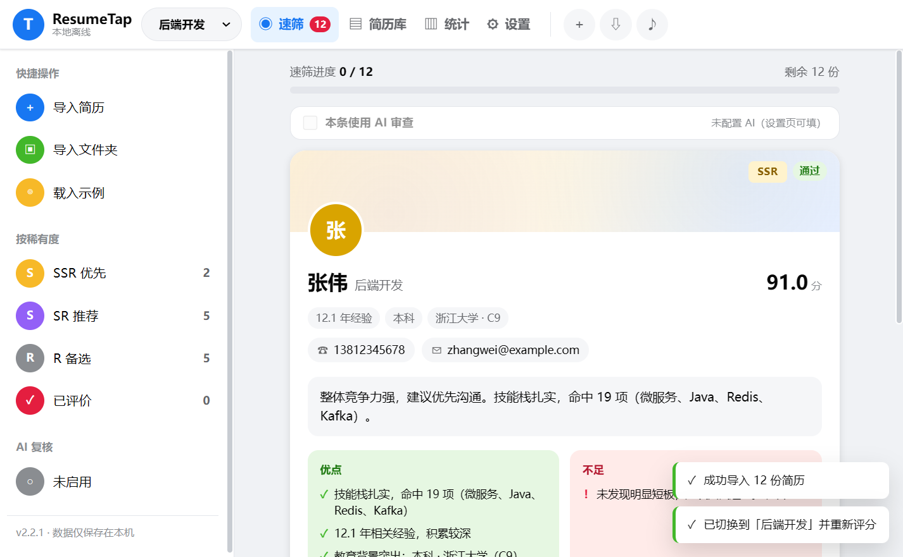
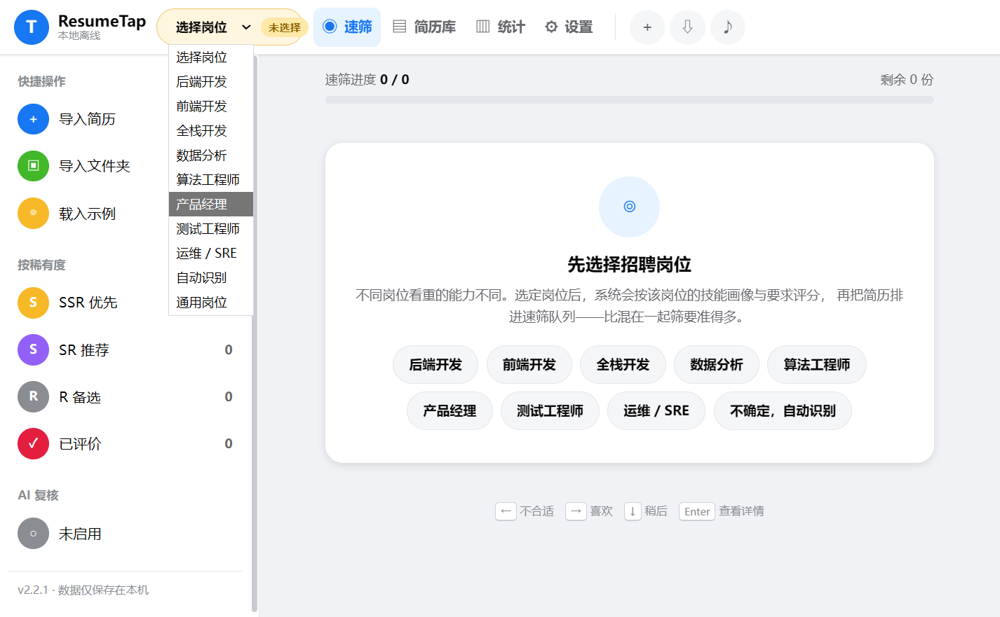
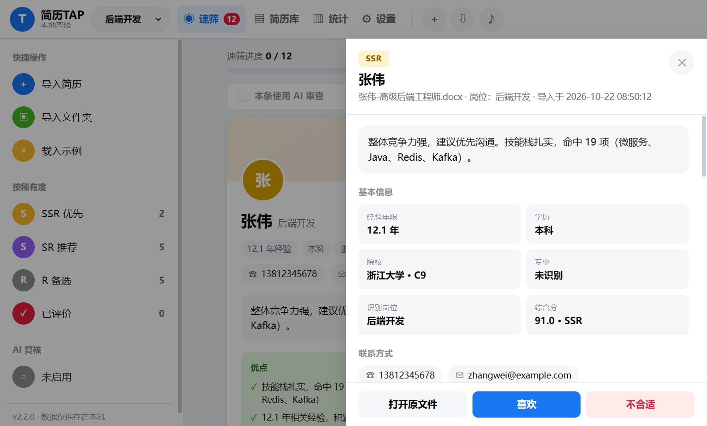
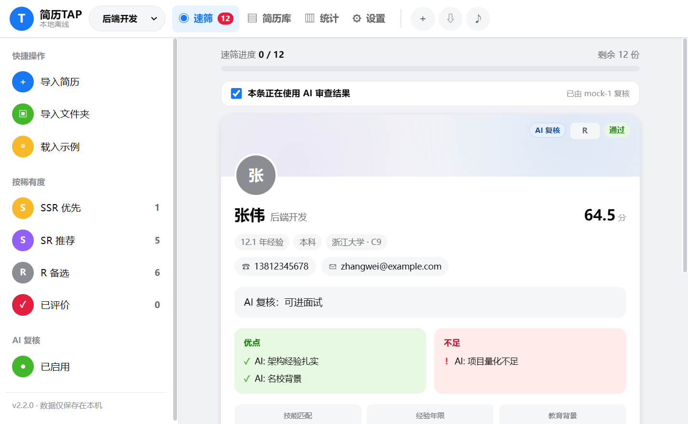

# ResumeTap

> 本地离线的简历速筛桌面应用。先选定要招的岗位，再逐份过简历：软件给出**优点、缺点、评分理由**，你只需按 `喜欢 / 不合适 / 稍后` 做决定。可选接入你自己的 AI 做二次复核。

**纯本地运行**：不联网、不上传、不监听公网。所有数据保存在 `%APPDATA%\ResumeGacha`。



---

## 目录

- [快速开始](#快速开始)
- [核心流程：逐份速筛](#核心流程逐份速筛)
- [本地 AI 审查 API](#本地-ai-审查-api)
- [评分规则](#评分规则)
- [学历与院校分层](#学历与院校分层)
- [稀有度阈值](#稀有度阈值)
- [界面与快捷键](#界面与快捷键)
- [从源码构建 exe](#从源码构建-exe)
- [目录结构](#目录结构)
- [常见问题](#常见问题)
- [隐私说明](#隐私说明)
- [验收清单](#验收清单)

---

## 快速开始

### 方式一：直接运行 exe（推荐）

从 [Releases](https://github.com/iATOEL/ResumeTap/releases/latest) 下载 `ResumeTap.exe`（即界面里的「ResumeTap」），双击运行：

1. 首次启动自动创建配置与数据库
2. 顶部先选择要招聘的岗位
3. 点「导入简历」或把 PDF / DOCX / TXT 拖进窗口
4. 自动进入速筛，按提示逐份看简历

> 无需安装 Python，也无需任何运行环境。Windows 10/11 自带所需组件。
> exe 不放进仓库（二进制文件会让仓库体积随每次构建翻倍），请从 Releases 获取。

### 方式二：从源码运行

```bash
python -m venv .venv
.venv/Scripts/pip.exe install -r requirements.txt
.venv/Scripts/python.exe run_app.py
```

调试模式（打开开发者工具）：

```bash
RESUME_GACHA_DEBUG=1 .venv/Scripts/python.exe run_app.py
```

---

## 核心流程

### 第一步：选择招聘岗位

打开应用后先选定要招的岗位（后端 / 前端 / 全栈 / 数据 / 算法 / 产品 / 测试 / 运维），
系统会按该岗位的技能画像与要求打分。**不选岗位就不能开始速筛**——把不同岗位的简历混在一起筛，
评分是没有意义的。

顶部随时可以切换岗位，切换后全库自动重新评分。

### 第二步：逐份速筛

选定岗位后，系统按综合分从高到低排队，一次只呈现一份简历：

```
┌──────────────────────────────────────────┐
│  速筛进度  3 / 12              剩余 9 份   │
│  ████████░░░░░░░░░░░░░░░░░░░░░░░░░░░░░░  │
├──────────────────────────────────────────┤
│  (张)              [SSR] [通过]           │
│                                          │
│  张伟  后端开发                    91.2 分 │
│  12.1 年经验 · 本科 · 浙江大学 · C9        │
│                                          │
│  整体竞争力强，建议优先沟通。技能栈扎实…    │
│                                          │
│  优点 ✓              不足 !               │
│  ✓ 技能栈扎实，命中 19 项  ! 未发现明显短板 │
│  ✓ 12.1 年相关经验                        │
│  ✓ 教育背景突出：本科·浙江大学（C9）        │
│                                          │
│  技能 100 | 经验 100 | 学历 100 | …       │
│  [微服务] [Java] [Kafka] [Redis]         │
│                                          │
│  ✕ 不合适      ↓ 稍后      ♥ 喜欢         │
└──────────────────────────────────────────┘
```

- **联系方式**：识别到的手机号与邮箱直接显示在卡片上（未识别会明确标注）。
- **教育经历**：逐段列出毕业院校全名、院校层级（C9/985/211/双一流/海外/普通/专科）、学历、专业、起止时间。
- **优点 / 不足**由规则引擎逐条生成，不是固定模板：技能命中数、年限、院校层级、项目量化、岗位匹配度各自独立判断。
- 三档操作：`喜欢`（进入候选）、`不合适`（排除）、`稍后`（暂不决定）。
- 点卡片任意位置可打开完整详情（六维得分、评分理由、命中技能与上下文、项目经历、简历原文）。
- 全部看完后进入完成页，可一键导出。

---

## AI 复核（可选，自带 Key）

如果你有自己的 OpenAI 兼容接口（OpenAI、DeepSeek、通义、本地 Ollama 等），可以让 AI 对每份简历做二次复核。

**默认完全关闭**：不填 Key 就不联网，纯规则引擎照常工作。

### 配置

**设置 → AI 复核（可选）**：

| 字段 | 说明 |
|---|---|
| 启用 AI 复核 | 总开关，必须勾选且填了 Key 才生效 |
| 接口地址 | `https://api.openai.com/v1` 这类 Base URL，程序自动补 `/chat/completions` |
| API Key | 仅写入本机 `config.yaml`，界面里以密码框保存 |
| 模型 | 如 `gpt-4o-mini`、`deepseek-chat` |
| 超时 | 单次请求秒数，默认 60 |
| AI 结果替换规则引擎 | 开启：AI 的分数与优缺点直接替换规则结果；关闭：仅作参考附注 |

填完点 **「测试连接」** 会先用一条极短请求验证 Key 是否可用。

### 两种使用方式

**1. 速筛时单份复核**

速筛页卡片上方有「本条使用 AI 审查」开关。勾选后调用一次 AI：

- 综合分、稀有度、六维得分、优点、不足、结论全部换成 AI 的结果
- 卡片右上出现 `AI 复核` 徽标
- 详情抽屉里保留 AI 的原始评分理由

**2. 批量复核**

设置页的「批量复核当前入围」会对最多 10 份简历顺序调用（避免触发限流），
批量失败会逐条提示原因。

### 失败处理

- Key 无效 / 无权限 → 提示检查设置
- 429 限流 / 额度不足 → 提示稍后重试
- 超时 → 提示检查网络或调大超时
- 返回不是合法 JSON → 自动重试一次（去掉 `response_format` 兼容老服务）

任何情况下 AI 失败都不会破坏原有规则评分。

---

## 对外审查 API

应用会在 `127.0.0.1:8765` 提供一个本地 JSON API，供**外部** AI / Agent 读取评分结果并回写结论。

> **默认关闭**。需要在设置页点「启动 API」才会运行；勾选「随应用自动启动」后下次开机自动起。

**安全设计**：

- 只监听 `127.0.0.1`，不接受外部网络访问
- 所有接口（除 `/health`）必须携带启动时随机生成的令牌
- 默认**不返回**简历原文与联系方式
- 令牌可在设置页重置

### 获取令牌

打开 **设置 → 本地 AI 审查 API**，页面会显示当前端口与令牌。也可用 `curl` 检查：

```bash
curl http://127.0.0.1:8765/health
# {"ok": true, "app": "resume-gacha", "version": "2.1.0", "auth_required": true}
```

### 接口一览

| 方法 | 路径 | 说明 |
|---|---|---|
| GET | `/health` | 健康检查（无需令牌） |
| GET | `/` | 接口说明 |
| GET | `/candidates` | 候选人列表，含评分、优缺点、维度理由 |
| GET | `/candidates/{id}` | 单份完整详情（含简历分段原文） |
| GET | `/stats` | 统计与速筛进度 |
| GET | `/config` | 当前权重、阈值、筛选规则 |
| GET | `/export?format=json\|csv\|md` | 导出并返回文件路径 |
| POST | `/review` | 回写单份审查结论 |
| POST | `/review/batch` | 批量回写 |

**查询参数**：`rarity=SSR|SR|R`、`min_score=70`、`pending=1`、`sections=1`、`limit=100`

### 调用示例

```bash
TOKEN="你在设置页看到的令牌"

# 1. 读取待审简历
curl -H "X-API-Token: $TOKEN" \
  "http://127.0.0.1:8765/candidates?pending=1&limit=5"

# 2. 读取单份详情
curl -H "X-API-Token: $TOKEN" \
  "http://127.0.0.1:8765/candidates/1"

# 3. 回写 AI 审查结论
curl -X POST -H "X-API-Token: $TOKEN" \
  -H "Content-Type: application/json" \
  -d '{"id":1,"verdict":"liked","note":"AI 复核：技能与岗位高度匹配"}' \
  "http://127.0.0.1:8765/review"
```

### 返回结构（节选）

```json
{
  "id": 1,
  "name": "张伟",
  "score": 91.2,
  "rarity": "SSR",
  "status": "pass",
  "review_verdict": "",
  "years": 12.1,
  "degree": "本科",
  "school": "浙江大学",
  "school_tier_label": "C9",
  "detected_role_label": "后端开发",
  "news_flash": "整体竞争力强，建议优先沟通。技能栈扎实，命中 19 项…",
  "strengths": ["技能栈扎实，命中 19 项（微服务、Java、Redis、Kafka）", "…"],
  "weaknesses": ["未发现明显短板，建议面试进一步确认"],
  "dimensions": [
    {"key": "skill", "label": "技能匹配", "score": 100, "weight": 0.27,
     "reason": "识别到 19 项技能，覆盖 6 个类别…"}
  ],
  "skills": [{"name": "微服务", "category": "后端与架构", "count": 5}]
}
```

> 设计意图：AI 拿到的是**已经算好的结构化结论**，不需要重新解析简历，也拿不到隐私原文。AI 的职责是二次复核与判断，而不是替代评分。

---

## 评分规则

综合分 = 六个维度得分 × 各自权重之和，落在 0–100。

| 维度 | 默认权重 | 计分方式 |
|---|---|---|
| 技能匹配 | 22% | 技能词典命中数量 + 类别广度 + 岗位核心技能加分 |
| 经验年限 | 18% | 显式年限或任职区间推算，曲线增长 |
| 教育背景 | **20%** | 学历基准分 + 院校层级加分（见下节） |
| 项目经历 | 18% | 项目数量 + 主导性动词 + 量化成果 + 大规模描述 |
| 关键词命中 | 10% | 自定义关键词或 JD 关键词命中率；未配置时不计入 |
| 岗位匹配 | 12% | 目标岗位画像的核心要求加权覆盖率 |

**应届生保护**：当经验 < 2 年时，系统自动把学历权重放大 1.75 倍、经验权重压到 0.45 倍。
否则"没经验"会把所有人压成同一档，名校与中专生无法区分。可在 `scoring.early_career` 调整。

几个关键实现：

- **年限不会把上学时间算进去**：只取「工作经历」章节的日期区间，多段经历按自然月合并去重，实习/兼职按半权计。
- **`JavaScript` 不会被算成 `Java`**：英文按词边界匹配。
- **未配置关键词时权重归零**，其余维度自动归一化，避免所有人被无意义拉低。
- **信息缺失不等于零分**：没写项目章节、没识别到技能、信息量太少无法判断岗位匹配时，
  该维度标记为"未参与"并从权重中剔除，而不是判 0 分拖垮总分。
- **岗位可自动识别**：默认 `role: auto`，按技能命中推断最匹配的岗位画像（后端/前端/全栈/数据/算法/产品/测试/运维）。

### 配置文件

```
%APPDATA%\ResumeGacha\config.yaml
```

首次启动自动生成，带中文注释。修改后在**设置页点「保存并重新评分」**立即生效（不重新解析文件）。也可参考 [config.example.yaml](config.example.yaml)。

> 配置带版本号，升级 exe 时会自动补齐新增字段，并**保留你手动改过的阈值**。

---

## 学历与院校分层

学历分不再只看"本科/硕士"六个字，而是 **学历层次 + 院校层级** 两层：

| 层级 | 示例 | 加分 |
|---|---|---|
| C9 | 清华、北大、浙大、复旦、上交、中科大、南大、哈工大、西交 | +26 |
| 985 | 电子科技大学、武汉大学、中山大学… | +20 |
| 海外顶尖 | 麻省理工、斯坦福、牛津、剑桥、港大… | +20 |
| 211 | 南京理工、暨南大学、上海财经… | +15 |
| 双一流 | 上海科技、南方科技、宁波大学… | +12 |
| 海外院校 | 香港城市、曼彻斯特、首尔大学… | +12 |
| 普通本科 | 其他大学/学院 | +4 |
| 专科院校 | 职业技术学院、职业学院 | +0 |

学历基准分：博士 100 / 硕士 86 / 本科 70 / 大专 44 / 中专高中 24。
差距刻意拉大：同样零经验，中专学历约 17 分（R），北大本科约 63 分（接近 SR）。

**学历识别做了防误判**：

- 跳过"本科及以上""要求本科"这类**招聘要求**行，不当作候选人学历
- 优先采信带日期、院校、毕业字样的教育经历行
- 多段学历取最高（本科 + 硕士 → 硕士）

> 院校名单不追求穷尽。可在 `config.yaml` 的 `scoring.education` 调整每一档加分。

---

## 稀有度阈值

| 稀有度 | 默认阈值 | 含义 |
|---|---|---|
| SSR | ≥ 82 | 优先沟通 |
| SR | ≥ 66 | 值得进一步了解 |
| R | < 66 | 备选或暂不推进 |

在 **设置 → 稀有度阈值** 用滑块调整，下方实时预览三档区间。滑块已针对浅色主题做了高对比度处理（8px 轨道 + 蓝色填充 + 白色描边）。

> 建议：先跑一批真实简历看分布，再微调。SSR 超过 20% 就上调 3–5 分，全是 R 就下调。

---

## 界面与快捷键

| 快捷键 | 功能 |
|---|---|
| `←` | 不合适 |
| `→` | 喜欢 |
| `↓` | 稍后 |
| `Enter` | 打开当前简历详情 |
| `Ctrl + O` | 导入简历 |
| `/` 或 `Ctrl + F` | 聚焦搜索 |
| `Esc` | 关闭详情 / 取消拖拽 |

- **顶部导航**：速筛 / 简历库 / 统计 / 设置，速筛标签上的红色数字是待看份数。
- **侧边栏**：按稀有度快速跳转到简历库。
- **简历库**：列表/网格切换、搜索、经验/学历筛选、按分数/年限/姓名/时间排序、右键或勾选批量操作。
- **拖拽导入**：把文件拖到窗口任意位置。

| 选择岗位 | 逐份速筛 |
|---|---|
|  |  |

| 详情抽屉 | AI 复核生效 |
|---|---|
|  |  |

---

## 从源码构建 exe

```bash
.venv/Scripts/python.exe build.py            # 单文件 exe（默认）
.venv/Scripts/python.exe build.py --onedir   # 目录版（启动更快）
```

产物：项目根目录的 `ResumeTap.exe`（约 43 MB，已被 `.gitignore` 排除，不会误提交）

构建脚本会自动：生成图标 → 检查/生成示例简历 → 清理 → PyInstaller 打包。

手动构建：

```bash
.venv/Scripts/python.exe -m PyInstaller --noconfirm --clean --onefile \
  --name "ResumeTap" --windowed \
  --add-data "ui;ui" --add-data "assets;assets" --add-data "samples;samples" \
  --hidden-import webview.platforms.edgechromium \
  --icon assets/icon.ico \
  run_app.py
```

单文件首次启动需解压（约 2–4 秒），目录版约 1 秒。

---

## 目录结构

```
resume-gacha/
├── run_app.py                  # 打包入口
├── build.py                    # 一键构建
├── requirements.txt
├── config.example.yaml         # 配置示例（Java 后端岗位）
├── app/
│   ├── __main__.py             # 窗口启动、WebView2 检测、API 拉起
│   ├── bridge.py               # JS ↔ Python 桥
│   ├── ai_review.py            # AI 复核（用户自备接口）
│   ├── api.py                  # 对外审查 HTTP API（默认关闭）
│   ├── config.py               # 配置加载/校验/版本迁移
│   ├── parser.py               # PDF / DOCX / TXT 解析
│   ├── extractor.py            # 结构化抽取
│   ├── schools.py              # 院校分层库
│   ├── scoring.py              # 六维评分 + 优缺点生成
│   ├── rules.py                # 技能词典、岗位画像
│   ├── storage.py              # SQLite（含人工评价）
│   ├── services.py             # 导入/重评分/导出/统计
│   └── paths.py
├── ui/                         # 原生 HTML/CSS/JS，无 CDN
│   ├── index.html
│   ├── css/style.css
│   └── js/{app.js, charts.js}
├── assets/icon.ico
├── samples/                    # 12 份示例简历（含 PDF）
├── tests/                      # 106 项测试
├── docs/screenshots/
└── tools/                      # 示例生成、图标、界面自检、exe 验收
```

### 数据目录

```
%APPDATA%\ResumeGacha\
├── config.yaml     # 你的配置
├── data.db         # 评分结果、结构化信息、人工评价
├── resumes/        # 导入的简历副本
├── exports/        # 导出文件
└── logs/app.log    # 日志（自动轮转、已脱敏）
```

---

## 常见问题

**双击 exe 没反应 / 闪退？**

查看 `%APPDATA%\ResumeGacha\logs\app.log`。常见原因：缺少 WebView2 运行时（应用会弹窗提示安装）；被杀毒软件拦截（添加信任，或用 `--onedir` 构建）。

**API 的 fetch 在页面上失败？**

页面自身不需要调用 API（界面直接走进程内桥接）。API 是给**外部**程序用的，请用 `curl` 或 Python `requests` 从命令行/脚本调用。浏览器页面因 `file://` 的 CORS 限制无法直接 fetch。

**AI 能拿到简历原文吗？**

默认不能。`/candidates` 只返回结构化评分与理由；`/candidates/{id}` 返回分段文本（教育/工作/项目/技能），但不含联系方式与完整原文。只有开「保存简历原文」并在详情页手动展开才能看到完整原文（界面内）。

**支持 `.doc` 或扫描版 PDF 吗？**

不支持 `.doc`/`.wps`（另存为 `.docx` 或 PDF）。扫描件 PDF 只有图片，会提示"未从 PDF 中提取到文字"，需要先 OCR。

**为什么某份简历分数偏低？**

打开详情看六维明细与"不足"项。最常见原因是简历没有「工作经历」「项目经历」这类小标题，导致章节切分失败、经验与项目维度拿不到分。

**改了阈值，为什么详情里的分数没变？**

阈值只影响**稀有度分级**（SSR/SR/R），不改变综合分。改权重才会改变分数。

**速筛标记错了怎么办？**

完成页有「重新开始」，或在简历库勾选后重新评价。设置页的「重新评分」不影响人工评价。

**导入重复文件会怎样？**

按内容 SHA-256 去重，重复导入自动跳过并提示。

**换电脑怎么迁移？**

复制整个 `%APPDATA%\ResumeGacha` 到新电脑同名位置。

---

## 隐私说明

- **全程本地**：不发起网络请求（API 是本机回环），不依赖 CDN。
- **原文可控**：可关闭原文保存（`privacy.store_raw_text: false`）。
- **日志脱敏**：只记录文件名、数量、异常类型，不记录正文、手机号、邮箱。
- **API 隔离**：仅 `127.0.0.1` + 令牌鉴权，默认不返回联系方式与原文。
- **导出安全**：CSV 对以 `= + - @` 开头的字段做公式注入转义。

---

## 验收清单

| # | 验收项 | 结果 | 证据 |
|---|---|---|---|
| 1 | 双击 exe 启动，无需开发环境 | ✅ | `ResumeTap.exe` 在主目录，独立启动自动建库 |
| 2 | 先选岗位再速筛 | ✅ | 未选岗位显示岗位选择页，选中后进入队列 |
| 3 | 切换岗位后全库重新评分 | ✅ | 后端 vs 前端评分不同，自动重算 |
| 4 | 卡片显示毕业院校全名与层级 | ✅ | 逐段列出「浙江大学 · C9」等 |
| 5 | 显示联系方式 | ✅ | 卡片与详情均显示手机号、邮箱；未识别明确标注 |
| 6 | 学历权重足够、名校与中专分档 | ✅ | 零经验：中专 17 分 vs 北大 63 分 |
| 7 | 批量导入（含 PDF/DOCX/TXT） | ✅ | 12 份示例全部成功 |
| 8 | 拖拽导入可用 | ✅ | 真实 exe 内拖入单/多文件成功，文件名保留 |
| 9 | 拖拽异常文件有友好提示 | ✅ | 损坏 DOCX、.doc、超 25MB 均明确报错 |
| 10 | 速筛逐份展示优缺点 | ✅ | 每份含优点/不足/一句话结论/六维得分 |
| 11 | 快速操作与键盘 | ✅ | 按钮 + ←/→/↓，进度实时推进 |
| 12 | 详情含评分理由 | ✅ | 六维理由、命中技能上下文、项目、原文 |
| 13 | 搜索/筛选/排序/视图切换 | ✅ | 搜索、稀有度、经验、学历、列表/网格 |
| 14 | 导出含关键字段 | ✅ | CSV/JSON/MD 含分数、稀有度、优缺点、联系方式、教育经历、评分来源 |
| 15 | AI 复核（自带 Key，默认关闭） | ✅ | 未配置时开关禁用；配置后分数与优缺点被替换并标记 AI |
| 16 | AI 失败不影响规则评分 | ✅ | Key 无效/超时/限流均有提示，原分数保留 |
| 17 | 对外 API（默认关闭） | ✅ | 设置页手动启动，回环 + 令牌鉴权 |
| 18 | 无成就模块 | ✅ | 已移除 |
| 19 | 异常输入不崩溃 | ✅ | 空文件、损坏、旧格式、加密 PDF、外部格式 |
| 20 | 自动化测试 | ✅ | `pytest tests/ -q` → 106 passed |
| 21 | 构建可复现 | ✅ | `python build.py` 约 25 秒，产物在主目录 |

## 许可证

MIT
